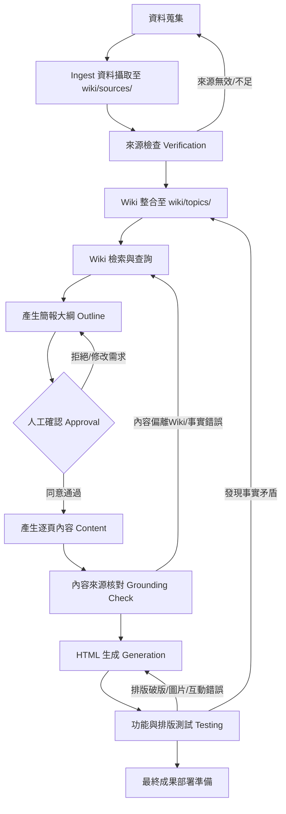

# AGENTS.md：濟州島自由行專案 AI 工作規範

本專案為大學 AI 課程第十週作業，專案名稱為**「第一次去濟州島自由行完整攻略」**。
整體任務目標為：**先建立結構化的 LLM Wiki 作為嚴謹知識庫，再以該 Wiki 為唯一事實來源，打造 12～15 頁的繁體中文「互動式 HTML 教學簡報」，最終成果預計部署至 GitHub Pages。**

所有參與本專案之 AI Agent 均須嚴格遵守以下工作準則與執行規範。

---

## 一、專案核心工作原則 (Core Working Principles)

1. **先討論、後生成**：重大結構、大綱設定或設計決策，必須先與使用者討論並獲得確認後方可執行生成，嚴禁自作主張。
2. **最小更動原則**：每次修改與重構僅改動必要檔案與區塊，不隨意更動不相關的程式碼或文件結構。
3. **規格鎖定**：未經使用者明確指示或確認，不得擅自變更已定案之主要規格與設計原則。
4. **資訊安全與隱私**：嚴禁將任何 API Key、密碼、Token 或私人機密資訊加入程式碼或公開專案中。
5. **嚴禁事實捏造 (Zero Hallucination)**：租車資格、交通法規、門票價格、營業時間、匯率與行政手續等真實旅遊數據，必須嚴格源自真實查證資料，嚴禁無中生有或臆測。
6. **本階段工作界限**：建立本規範檔案（`AGENTS.md`）即完成當前任務，**嚴禁擅自開始蒐集資料、建立 Wiki 檔案或製作 HTML 簡報**。

---

## 二、LLM Wiki 規範 (LLM Wiki Specification)

### 1. 知識庫架構與分類
Wiki 知識庫必須涵蓋以下六大核心主題：
1. **行前準備**：機票與航班、入境規範（K-ETA/護照）、換匯與信用卡、eSIM/網卡、氣候穿搭、行李打包清單。
2. **交通與租車**：
   - **自駕攻略（詳細介紹）**：國際駕照資格（IDP 類別 A/B 規範）、年齡與駕役限制、保險類別（CDW 完全免責）、韓文導航系統（Naver Map / KakaoMap 電話號碼定位法）、交通法規（紅燈右轉規定、限速測速）、加油與還車流程、事故處理 SOP。
   - **大眾運輸**：急行巴士（紅色）、幹線/支線巴士、觀光循環巴士、T-money 交通卡使用與儲值、Kakao T 計程車叫車與包車一日遊。
3. **住宿區域**：濟州市區（蓮洞/老衡洞）、西歸浦市區、城山日出峰一帶、涯月/中文觀光區之優缺點分析與住宿建議。
4. **熱門景點**：東線（城山日出峰、牛島、涉地可支）、西線（涯月邑海岸公路、挾才海灘）、南線（中文旅遊區、柱狀節理、西歸浦瀑布）、濟州市區景點，含門票收費與預約注意事項。
5. **美食與購物**：黑豬肉、白帶魚料理、海女包飯、柑橘甜點、傳統市場（東門市場、每日偶來市場）、免稅店與濟州限定伴手禮。
6. **行程規劃**：初訪者 4天3夜 / 5天4夜 經典環島/分區路線示範、順時針 vs 逆時針路線安排、防雷與避坑指南。

### 2. 資料來源標準與數量
- **來源類型**：必須採用官方旅遊入口（如 Visit Jeju 濟州觀光公社、韓國觀光公社、駐外辦事處、租車業者官方條款）及高品質繁體中文旅遊部落格/攻略。
- **資料數量**：至少 Ingest 5 篇真實資料，目標達成 8～10 篇。

### 3. 目錄結構與雙向連結
- `wiki/sources/`：存放來源筆記（Source Notes），檔名規範例如 `SRC-01.md`, `SRC-02.md`。
- `wiki/topics/`：存放主題知識筆記（Topic Notes），檔名規範例如 `prep.md`, `transport.md`, `stay.md`, `spots.md`, `food.md`, `itinerary.md`。
- **雙向連結機制**：
  - 來源筆記必須連結至其所支援的主題筆記（例如 `關聯主題：[[topics/transport]]`）。
  - 主題筆記中每一個事實數據必須反向標註來源引用編號（例如 `[[sources/SRC-01]]`）。

### 4. 來源筆記必備 Metadata 格式
每篇儲存於 `wiki/sources/` 的檔案必須包含以下 YAML Frontmatter 或結構化標頭：
```markdown
---
id: "SRC-01"
title: "來源完整標題"
url: "https://example.com/source-url"
published_date: "YYYY-MM-DD" # 若未知則填寫未知
access_date: "YYYY-MM-DD"
author_or_site: "發布單位或網站名稱"
topics:
  - "交通與租車"
  - "行前準備"
---

## 來源摘要
（精簡陳述該來源之核心重點與適用範圍）

## 萃取事實條目 (Extracted Facts)
- 事實項目 1（例：台灣旅客於韓國租車須持本國駕照 + IDP 國際駕照 Class B）
- 事實項目 2
```

### 5. 整合與衝突檢核機制
- **入庫比對**：新增資料進入 Wiki 前，必須先與既有資料比對，檢視是否有重複內容或事實衝突（例如：不同年份的租車年齡限制或公車計費機制）。
- **衝突處理與資料查證原則**：當不同資料來源發生衝突時，必須依循以下嚴謹查證規則：
  1. **比對來源與適用性**：先比較來源出處、發布或更新日期，以及該資訊的適用條件與時空背景。
  2. **正式規定以官方為準**：凡涉及入境規範（如 K-ETA、護照效期）、國際駕照資格、交通法規等正式制度，以適用的主管機關或官方最新公告為主要依據。
  3. **區分客觀事實與主觀心得**：涉及個人旅遊經驗、美食或住宿評價時，應明確區分「客觀事實」（如地址、營業時間、收費定價）與「主觀心得」（如口味喜好、個人觀感）。
  4. **未決標註為待查證**：若無法確認何者正確，應在筆記中明確標記為「待查證」，嚴禁自行猜測、隨意選擇或編造答案。

---

## 三、HTML 簡報規範 (Interactive HTML Presentation Specification)

1. **簡報規模與語言**：12～15 頁，純繁體中文（台灣習慣用語）。
2. **目標受眾**：第一次前往濟州島自由行的旅客，注重動線清晰、步驟具體、避坑實用。
3. **視覺與設計風格**：
   - **主題風格**：濟州海洋清新風（清新、明亮、度假感、現代簡潔）。
   - **配色方案**：
     - 主色：海洋藍（Ocean Blue）
     - 輔色：薄荷綠（Mint Green）
     - 背景色：米白色 / 暖白底（Off-White / Cream）
     - 點綴強調色：濟州橘子柑橘色（Tangerine Orange）
4. **互動與版面功能**：
   - 具備完整翻頁機制（上一頁、下一頁按鈕，支援鍵盤方向鍵 `ArrowLeft` / `ArrowRight` 導航，頁碼進度指示器）。
   - 頂部或側邊章節跳轉導航列（可直達六大核心主題）。
   - 交通模組具備「自駕 vs 大眾運輸」互動比較卡片或切換標籤。
   - 完全相容行動裝置與桌面螢幕之響應式網頁設計（RWD）。
5. **知識溯源標示**：
   - 簡報各頁面的重要數據與規定，均須標註對應之 Wiki 來源編號（例如 `[Wiki: SRC-02]`）。
   - 簡報最後一頁必須設置統一的「參考資料與 Wiki 來源清單」頁面。
6. **大綱先決與人工確認**：
   - 必須先生成「簡報詳細大綱」，包含頁數分佈、各頁標題、要點與互動元件規劃。
   - **大綱必須經過使用者人工確認（Approval）後，才獲准開始編寫 HTML 程式碼**。
7. **資料依據**：簡報中所有內容與推薦行程，必須 100% 來自已通過查證的 Wiki 內容，杜絕未收錄之外部猜測。

---

## 四、工作流程圖與反饋機制 (Loop / Graph Workflow)

### 1. 執行流程圖


### 2. 回溯路徑定義 (Backtracking Routing)
- **資料錯誤 / 矛盾**：返回【來源檢查】或【Wiki 整合】節點重新校對與修訂。
- **大綱結構問題**：返回【產生簡報大綱】節點重新調整，並**再次提交人工確認**。
- **內容事實錯誤**：返回【Wiki 檢索與查詢】或【產生逐頁內容】節點，以 Wiki 正確條目為準重新生成。
- **排版、樣式、圖片或互動故障**：返回【HTML 生成】節點修正 CSS、JS 或 DOM 結構。

### 3. 自動修復重試上限 (Retry Budget)
- **同一錯誤或同一節點問題，AI 最多連續自動修正 3 次**。
- 若修正達 3 次仍無法通過檢驗，AI 必須**立刻停止自動操作 (HALT)**，條列呈現錯誤日誌、已嘗試解法與障礙點，主動請求使用者人工指示。

---

## 五、檢查與紀錄規範 (Audit & Logging Rules)

為了符合課程對流程分析的要求，專案進行過程中必須嚴格落實過程紀錄：

1. **資料匯入日誌 (Ingestion Log)**：
   - 記錄於專案日誌中，記載每筆資料的來源編號、原文標題、網址、擷取日期、來源可信度判定。
2. **Graph 節點檢查紀錄**：
   - 記錄每個流程節點的輸入、輸出是否合規（如：大綱是否滿 12-15 頁？雙向連結是否有效？）。
3. **錯誤與修正審計追蹤 (Error & Backtrack Log)**：
   - **實際錯誤**：明確記錄發生的錯誤現象（如：公車路線編號不對、自駕保險名稱混淆、JS 換頁失效）。
   - **修正方式**：具體說明修改了哪些內容或程式碼。
   - **返回節點**：記錄退回至哪一個流程節點。
   - **重試次數**：累計該問題之修正次數（1～3 次）。
4. **真實性保證**：嚴禁假造執行成功紀錄、捏造測試結果或偽造除錯歷程。
5. **脆弱節點分析總結**：在專案完工時，須提供統計總結，分析在整個 Graph 流程中「最容易出錯的節點」為何，並檢討是否需要「提前檢查機制 (Shift-left Check)」。

---

## 六、GitHub Pages 部署準備標準

- 檔案路徑一律使用相對路徑（Relative Path），確保本機預覽與 GitHub Pages 靜態網站目錄架構一致。
- 程式碼結構清晰獨立，互動行為採純原生 JavaScript 或輕量級 CDN 套件（無伺服器後端依賴）。
- 確保所有靜態資源（CSS、圖示、樣式表）載入正確，避免產生 404 資源缺失問題。
