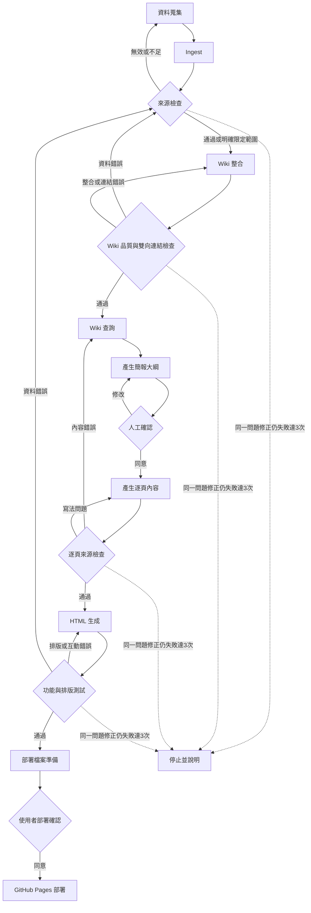

# Loop / Graph 工作流程

依 [AGENTS.md](../AGENTS.md) 與本次使用者授權執行。狀態日期：2026-11-16。先完成既有 Wiki 複核及七筆 Ingest，再產大綱；人工確認是進入逐頁內容與 HTML 的必要閘門。

## 節點輸入與輸出
| 節點 | 輸入 | 輸出／驗收 | 本階段狀態 |
| --- | --- | --- | --- |
| 資料蒐集 | 十筆原始網址、既有筆記 | 真實正文、日期、替代原因 | 已執行；限定範圍見來源審計 |
| Ingest | 可讀的原文 | 十筆來源筆記；保留原編號 | 已執行 |
| 來源檢查 | 原文、舊事實、衝突 | 官方／業者／心得分級，未支持項目降級 | 已執行 |
| Wiki 整合 | 採用的來源條目 | 六主題、索引及雙向連結 | 已執行 |
| Wiki 品質 | Markdown 與來源 metadata | 真實檢查輸出、人工範圍檢查 | 執行結果見品質報告 |
| Wiki 查詢 | 交通、住宿、分區與行程問題 | 大綱依據表，僅採用可用條目 | 已執行，查詢對照見大綱 |
| 大綱 | 六主題與受眾需求 | 12～15頁，逐頁來源與呈現形式 | 已完成15頁，使用者已確認 |
| 人工確認 | 完整大綱 | 使用者明確同意／修改意見 | 2026-11-16使用者明確確認 |
| 逐頁內容／再查來源 | 核准大綱與 Wiki | 完整頁面文案與逐條 grounding | 已完成，見內容查核 |
| HTML／測試 | 已核對文案 | CSS/JS、桌機手機、翻頁與連結 | 已生成，本機桌機／手機模擬測試通過 |
| 部署準備／發布 | 通過測試的檔案 | 相對路徑、使用者部署確認 | 相對路徑已準備；未發布，等待成品檢視 |

## 實際回溯事件
修正次數以「同一問題的一次修正方案」計，不把單純讀取／查詢次數當修正迴圈。

| 事件 | 實際現象 | 修正與回溯節點 | 次數／結果 |
| --- | --- | --- | --- |
| E01 | SRC-01入口不能直接支持全部細節，生效日當發布日 | 來源檢查→蒐集外交部公告→整合；未支持換照細節列待查證 | 1，採用範圍已釐清 |
| E02 | SRC-02香水60ml與關稅廳100ml衝突 | 來源檢查→Wiki整合；改100ml並限定韓國入境 | 1，已修正 |
| E03 | SRC-02宣稱紙本已全面取消，但現行Guide仍有紙本選項 | 來源檢查→Wiki整合；撤回全面取消結論，紙本適用性待查證 | 1，已隔離，不宣稱法規問題完全解決 |
| E04 | Q-CODE、管制藥品具體時限缺本次充分支持 | 來源檢查→Wiki整合；不當已確認規定輸出 | 1，降級待查證 |
| E05 | SRC-03補充頁標題錯誤，部分車種範圍過廣 | 來源檢查→核讀正文與City Bus→整合 | 1，支持市區公車政策，修正歸屬 |
| E06 | Bp8非自駕手冊正文，目的頁仍無該文件 | 資料蒐集→解析入口→改採警察廳公告 | 2，替代完成；原件未取得 |
| E07 | 警察廳官網頁讀取循環轉址 | 資料蒐集→讀政府政策平台署名原公告 | 1，替代正文可讀 |
| E08 | KKday右轉漏停車，油槍顏色推論不充分 | 來源檢查→Wiki整合；右轉用官方、油槍判定排除 | 1，已修正／隔離 |
| E09 | 莉莉嗯2024現金搭車資訊與新政策不同 | 來源檢查→Wiki整合；保留心得、支付用官方 | 1，已修正 |
| E10 | Mimi韓景點文仍寫駕照計畫開放 | 來源檢查→Wiki整合；官方互惠優先 | 1，已修正 |
| E11 | BringYou後續HTTP403 | 資料蒐集→同網址可讀索引段落；限定Ingest範圍 | 1，有限讀取完成，直連未恢復 |
| E12 | 本機首次檢查發現 itinerary 引用 SRC-05，但來源缺反向連結 | Wiki 品質→Wiki 整合；補來源回連與 topics metadata | 1，修正後另存重測輸出 |
| T01 | requests套件不存在 | 蒐集工具→改Python標準庫 | 1，已執行成功 |
| T02 | cp950無法輸出韓文 | 蒐集工具→stdout UTF-8 | 1，已執行成功 |

| T04 | 最終品質報告連到當次尚未寫出的JSON結果檔 | Wiki品質檢查→保留首次輸出→檔案產生後重測 | 1，重測427個相對連結通過 |
| T03 | 下拉選單方向鍵測試誤以為頁碼不應改變 | 功能測試→修正原生選單判準→單獨重測；產品程式不需更動 | 1，通過，首次失敗保留 |

原作者改網域屬轉址紀錄，不虛構成程式故障。本次HTML未發現排版或互動產品缺陷；T03屬測試錯誤，詳見[測試報告](../logs/presentation_test_report.md)。

## 哪些節點容易出錯
本次上述 11 個來源資料事件中，8 個集中在來源檢查／事實整合（E01～E05、E08～E10），3 個涉及資料取得（E06、E07、E11）；另有1個本機雙向連結問題（E12）與2個工具環境問題；HTML階段另發現1個測試判準問題（T03）與1個驗證產出順序問題（T04）。此為本次觀察，不能推論所有專案的統計錯誤率。

可提前的檢查：
- 先核對頁面真實標題、內容與日期，不憑網址或搜尋標題產摘要。
- 法規與安全主張先找主管機關；發現舊年份或推廣文章時先建立限制欄。
- 來源metadata、相對連結、雙向引用在每批整合後自動檢查。
- 把即時價格／開放／船班與穩定地點介紹分開，降低大綱再次產生無依據數字的機會。

同一問題第三次修正仍失敗就停止該自動操作並向使用者說明。本次未有第三次仍失敗的修正事件；明確允許的來源替代與待查證隔離不冒稱「問題本身已查明」。

[來源審計](../logs/source_audit.md) · [品質報告](../logs/quality_report.md) · [執行日誌](../logs/ingest_log.md) · [Wiki](../wiki/INDEX.md)

[15頁大綱與Wiki查詢對照](presentation_outline.md)
